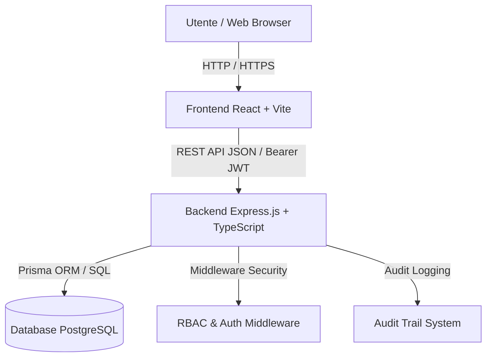
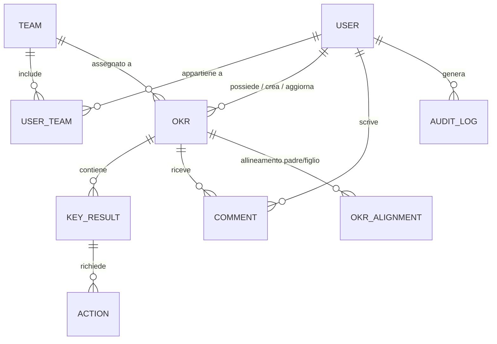

# Architettura e Struttura del Software di Gestione OKR

Questo documento descrive in dettaglio la struttura, l'architettura tecnica, il data model e i moduli funzionali del **Software di Gestione degli OKR (Objectives and Key Results) aziendali**.

---

## 1. Introduzione e Panoramica Generale

Il software è una **SaaS Web Application Full-Stack** progettata per supportare le aziende nella pianificazione strategica, nel tracciamento degli obiettivi (OKR) e nel monitoraggio delle performance a livello aziendale, di team e individuale.

### Cos'è la metodologia OKR?
- **Objectives (Obiettivi)**: Traguardi qualitativi, ispirazionali e a tempo definito (es. "Diventare il leader di mercato nell'assistenza clienti nel Q2").
- **Key Results (Risultati Chiave)**: Metriche quantitative e misurabili utilizzate per valutare il raggiungimento dell'obiettivo (es. "Aumentare il punteggio CSAT da 80% a 95%").
- **Actions (Azioni)**: Attività o task operativi collegati ai Key Results.

---

## 2. Architettura di Sistema

L'applicazione adotta un'architettura **Full-Stack Decoupled (Disaccoppiata)**, dividendo nettamente il livello di presentazione (Frontend Client-Side) dal livello di logica di business (Backend API REST) e dal livello di persistenza (Database Relazionale).

### Componenti Principali dello Stack Tecnologico:

| Livello | Tecnologie Utilizzate | Ruolo e Descrizione |
| :--- | :--- | :--- |
| **Frontend** | React 19, TypeScript, Vite, Tailwind CSS, Lucide Icons, Zustand | Interfaccia utente moderna SPA (Single Page Application), reattiva e responsive. |
| **Backend** | Node.js, Express.js, TypeScript | API RESTful per la logica di business, autenticazione, gestione ruoli e calcolo metriche. |
| **ORM** | Prisma ORM 7.0 | Astrazione del database, gestione delle migrazioni, type-safety end-to-end. |
| **Database** | PostgreSQL | Database relazionale per dati strutturati, relazioni complesse e tracciamento audit. |
| **Autenticazione** | JWT (JSON Web Token), bcryptjs | Autenticazione stateless basata su token con hashing sicuro delle password. |

---

## 3. Data Model e Schema del Database

Il modello dati è definito in `backend/prisma/schema.prisma` ed è strutturato attorno all'entità principale `Okr` e le sue relazioni.

### Entità Principali:

1. **`User` (Utente)**:
   - Campi: `id` (UUID), `email`, `password` (hash), `firstName`, `lastName`, `role` (Enum), `isActive` (Boolean).
   - Relazioni con Team, OKR posseduti/creati/aggiornati, Commenti, Audit Logs e Azioni.

2. **`Team` (Squadra / Dipartimento)**:
   - Campi: `id`, `name` (unico), `description`.
   - Collega gli utenti e raggruppa gli OKR a livello organizzativo.

3. **`Okr` (Obiettivo)**:
   - Campi: `id`, `title`, `description`, `objective`, `period` (es. "Q1 2026"), `startDate`, `endDate`, `status` (Enum), `progressPercentage` (Float 0-100), `priority` (Enum), `tags` (Array), `notes`, `deletedAt` (Soft Delete).
   - Relazioni: Proprietà (User), Team assegnato, Key Results contenuti, Allineamenti con altri OKR (Cascading).

4. **`KeyResult` (Risultato Chiave)**:
   - Campi: `id`, `okrId`, `title`, `description`, `initialMetric`, `targetMetric`, `currentMetric`, `unit` (es. "%", "€", "utenti"), `weight` (Peso % per il calcolo dell'avanzamento dell'OKR), `status`.

5. **`Action` (Iniziativa / Task)**:
   - Task operativi per raggiungere uno specifico Key Result, assegnabili a un utente con data di scadenza.

6. **`OkrAlignment` (Gerarchia OKR)**:
   - Relazione self-referencing N-to-N che collega OKR Padri (macro-obiettivi aziendali) a OKR Figli (obiettivi di team o individuali).

7. **`Comment` & `AuditLog`**:
   - `Comment`: Discussioni e feedback tra utenti su specifici OKR.
   - `AuditLog`: Registro immutabile di tutte le azioni critiche compiute sul sistema (creazione, modifica, eliminazione, cambio ruoli).

### Enumerazioni (Enum):
- **`Role`**: `ADMIN`, `MANAGER_OKR`, `TEAM_LEAD`, `VIEWER`
- **`OkrStatus`**: `IN_PIANIFICAZIONE`, `ATTIVO`, `IN_PAUSA`, `COMPLETATO`, `NON_RAGGIUNTO`
- **`Priority`**: `BASSA`, `MEDIA`, `ALTA`, `CRITICA`
- **`KeyResultStatus`**: `NON_INIZIATO`, `IN_PROGRESSO`, `ON_TRACK`, `AT_RISK`, `COMPLETATO`

---

## 4. Autenticazione e Controllo degli Accessi (RBAC)

Il sistema applica il modello **Role-Based Access Control (RBAC)** rigorosamente validato lato server.

### Matrice dei Ruoli e Permessi:

| Funzionalità / Permessi | Admin | Manager OKR | Team Lead / Contributor | Viewer |
| :--- | :---: | :---: | :---: | :---: |
| **Gestione Utenti (Creazione/Ruoli/Attivazione)** | ✅ Full | ❌ | ❌ | ❌ |
| **Accesso ai Log di Audit e DB Tools** | ✅ Full | ❌ | ❌ | ❌ |
| **Creazione / Modifica TUTTI gli OKR** | ✅ Full | ✅ Full | ⚠️ Solo propri / del team | ❌ |
| **Eliminazione OKR (Soft Delete)** | ✅ Full | ✅ Full | ❌ | ❌ |
| **Aggiornamento Metriche Key Results** | ✅ Full | ✅ Full | ✅ Sui propri OKR | ❌ |
| **Visualizzazione OKR e Reportistica** | ✅ Full | ✅ Full | ✅ Full | ✅ Sola lettura |
| **Commenti e Feedback** | ✅ Full | ✅ Full | ✅ Full | ✅ Full |

---

## 5. Struttura del Backend API REST

Il backend (`/backend`) segue una struttura modulare basata su Controller, Service, Middleware e Route:

- `src/routes/`: Definisce gli endpoint REST e i middleware di protezione per ciascuna risorsa (`auth`, `user`, `okr`, `team`, `action`, `dashboard`, `admin`).
- `src/controllers/`: Gestisce la logica delle richieste/risposte HTTP.
- `src/services/`: Contiene la business logic pura e le interazioni con Prisma ORM.
- `src/middleware/`:
  - `auth.ts`: Estrae e verifica l'Access Token JWT dagli header `Authorization: Bearer <token>`.
  - `rbac.ts`: Middleware `requireRole(...roles)` che blocca l'accesso agli utenti privi del ruolo necessario.
  - `validate.ts`: Validazione degli input tramite schemi Zod.
  - `errorHandler.ts`: Intercettore centralizzato degli errori HTTP.

### Algoritmo di Calcolo Avanzamento OKR:
Quando una metrica di un `KeyResult` viene aggiornata:
1. Si calcola la percentuale del singolo KR: `(metricaAttuale - metricaIniziale) / (metricaTarget - metricaIniziale) * 100`.
2. Si applica la ponderazione basata sul `weight` (peso) di ciascun Key Result.
3. Si aggiorna automaticamente la `progressPercentage` dell'OKR genitore.

---

## 6. Struttura del Frontend Interfaccia Utente (UI)

Il frontend (`/frontend`) è sviluppato in React 19 con Vite e Tailwind CSS:

- **`pages/Dashboard.tsx`**: Panoramica visiva delle metriche globali, grafici di stato, OKR at-risk e indicatori KPI.
- **`pages/OkrList.tsx`**: Elenco filtri avanzati (per team, stato, priorità, periodo), ricerca temporale e tabella interattiva.
- **`pages/OkrDetail.tsx`**: Vista dettagliata di un OKR con progress bar per Key Results, lista iniziative, thread di commenti, storico modifiche e allineamenti.
- **`pages/OkrForm.tsx`**: Form con validazione dinamica per creazione/modifica OKR e Key Results associati.
- **`pages/UserManagement.tsx`**: Pannello di amministrazione utenti (esclusivo Admin).
- **`pages/DatabaseManagement.tsx`**: Strumento di diagnostica e manutenzione database (esclusivo Admin).
- **`pages/UserManual.tsx`**: Guida e documentazione integrata nell'applicazione.

---

## 7. Meccanismi di Sicurezza e Integrità Dati

1. **Protezione Password**: Hashing con bcryptjs con salt adeguato.
2. **Soft Delete**: Gli OKR eliminati vengono contrassegnati con `deletedAt` anziché essere cancellati fisicamente, permettendo il recupero e l'audit trail.
3. **Audit Trail Immutabile**: Ogni azione critica (creazione OKR, cambio di ruolo utente, eliminazione) scrive un record in `AuditLog`.
4. **Sanitizzazione Input**: Protezione automatica da SQL Injection tramite Prisma ORM e parametri tipizzati.
